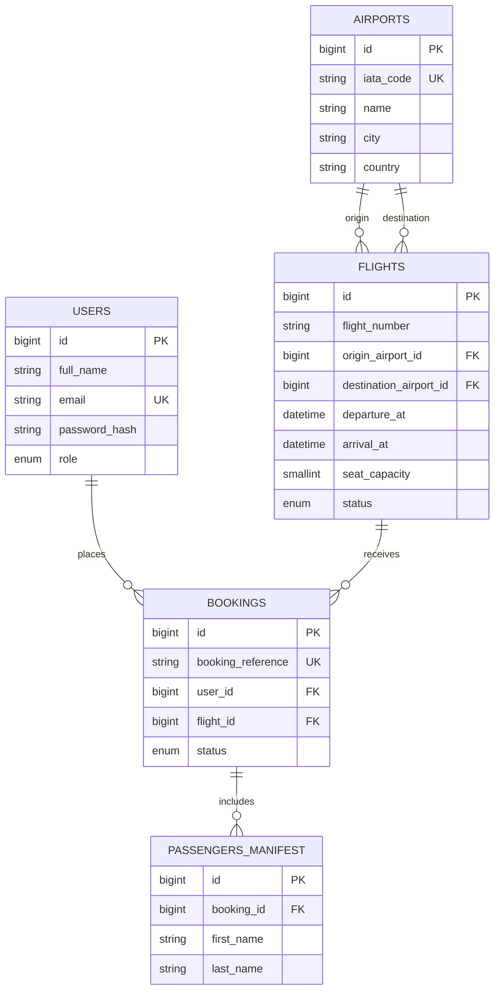

# Database ERD

## Entities and relationships

- One user account can place zero or many bookings; every booking has one account holder.
- One scheduled flight can have zero or many bookings; every booking is for one flight occurrence.
- An airport can be the origin of zero or many flights and separately the destination of zero or many flights. Each flight has exactly one of each.
- A booking can have zero or many manifest rows while it is being created. The booking workflow must add at least one traveler before confirming the booking. Every manifest row belongs to exactly one booking. This permits an application transaction to create the booking and its travelers atomically.
- Manifest travelers are not user accounts. The user recorded by a booking is the account holder, not necessarily every traveler.
- Flight occurrence is distinguished by flight number and departure time. The passenger count is derived from manifest rows and is not stored a second time.
- Booking references must be generated by application code using a cryptographically secure random source; the unique key prevents duplicates but does not itself make values unpredictable.
- `flights_validate_before_insert` and `flights_validate_before_update` reject identical origin/destination airports, arrival times that are not later than departure, and zero seat capacity. They raise explicit SQLSTATE `45000` errors.
- The project uses triggers for these flight invariants because the XAMPP MariaDB 10.11.16 target rejects the corresponding `CHECK` expression with error `#1901`.
- The schema uses `CREATE TABLE IF NOT EXISTS` so it can be imported over the current partial setup without dropping existing tables or data. This does not update a pre-existing table whose definition differs from the schema.

## Foreign-key delete/update policies

| Foreign key | On delete | On update | Rationale |
|---|---|---|---|
| `flights.origin_airport_id` → `airports.id` | `RESTRICT` | `CASCADE` | Keep airports used by flight history; propagate a changed surrogate key. |
| `flights.destination_airport_id` → `airports.id` | `RESTRICT` | `CASCADE` | Keep airports used by flight history; propagate a changed surrogate key. |
| `bookings.user_id` → `users.id` | `RESTRICT` | `CASCADE` | Preserve booking history if an account is referenced. |
| `bookings.flight_id` → `flights.id` | `RESTRICT` | `CASCADE` | Preserve bookings if a flight is referenced. |
| `passengers_manifest.booking_id` → `bookings.id` | `CASCADE` | `CASCADE` | Manifest rows are dependent details of a booking. |

Schema source: [`../database/schema.sql`](../database/schema.sql).

The PHP runtime must have both `PDO` and `pdo_mysql` enabled to use [`../config/db.php`](../config/db.php).
